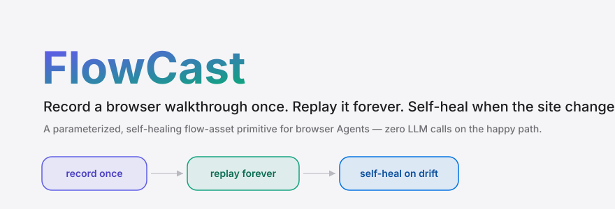
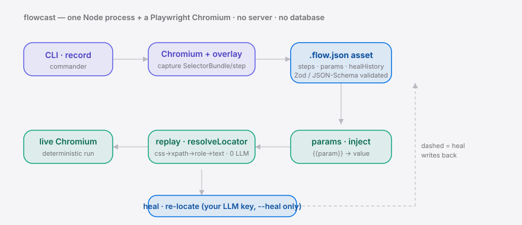

<div align="right"><sub><b>English</b>&nbsp;&nbsp;⇄&nbsp;&nbsp;<a href="./README.md">简体中文</a></sub></div>

<p align="center">
  <picture>
    <source media="(prefers-color-scheme: dark)" srcset="./assets/hero-dark.svg">
    <source media="(prefers-color-scheme: light)" srcset="./assets/hero-light.svg">
    
  </picture>
</p>

<p align="center"><sub>FlowCast is the record-once primitive that turns one browser demo into a self-healing, replayable Agent flow — record once, replay forever, re-locate automatically when the site changes.</sub></p>

<p align="center">
  <a href="./LICENSE"></a>
  
  <a href="https://github.com/SuperMarioYL/flowcast/actions/workflows/ci.yml"></a>
  = 22">
  
  
</p>

**Your browser Agent re-infers the same flow every run and re-breaks on every redesign — FlowCast records that one walkthrough into a parameterized, self-healing `.flow.json` asset, so replay is zero-LLM and selector drift heals itself.**

##  Architecture

<p align="center">
  <picture>
    <source media="(prefers-color-scheme: dark)" srcset="./assets/atlas-dark.svg">
    <source media="(prefers-color-scheme: light)" srcset="./assets/atlas-light.svg">
    
  </picture>
</p>

A single npm package: one Node process plus the Chromium it drives (managed by Playwright) — **no server, no database**. The LLM is invoked only on `--heal`, and only with your own key; normal replay makes zero model calls, which is exactly the win over re-inferring on every run.

## Table of contents

- [Why this exists](#why-this-exists)
- [Install](#-install)
- [Quickstart](#-quickstart)
- [Usage](#-usage)
- [Demo](#-demo)
- [Configuration](#-configuration)
- [The flow-asset primitive](#the-flow-asset-primitive)
- [vs adjacent tools](#vs-adjacent-tools)
- [Pricing / hosted tier](#-pricing--hosted-tier)
- [Roadmap](#-roadmap)
- [License](#-license)

## Why this exists

Today's browser Agents have one root flaw: every multi-step web task is **re-inferred** from scratch, and **re-breaks** whenever a selector drifts — run the same flow ten times and you rediscover it ten times, paying the cost and the flakiness over and over. The adjacent ecosystem has proven that self-healing browser automation is a real need (e.g. [browser-use/browser-harness](https://github.com/browser-use/browser-harness)'s single-run self-heal), but it heals *within one live run* and discards everything after — no reusable asset.

FlowCast fills exactly that gap: it **crystallizes** one human demo into a parameterized, self-healing, replayable flow asset. That turns a one-off demo into a **durable browser-Agent capability** — the same backbone as projects like [NousResearch/hermes-agent](https://github.com/NousResearch/hermes-agent) pushing "Agent" toward reliable execution, but focused on the specific primitive: record once, replay forever, self-heal on change.

##  Install

```bash
npm install -g flowcast          # or just npx flowcast <command>
npx playwright install chromium  # one-time browser engine install
```

##  Quickstart

The repo ships a runnable sample asset, so a fresh clone shows zero-LLM replay without recording anything:

```bash
git clone https://github.com/SuperMarioYL/flowcast && cd flowcast
npm install && npx playwright install chromium
npx flowcast replay examples/login-and-export.flow.json
```

<details><summary>sample output</summary>

```text
→ s1 goto https://the-internet.herokuapp.com/login
→ s2 fill (fill username)
→ s3 fill (fill password)
→ s4 click (click Login)
→ s5 waitFor
→ s6 extract = "Welcome to the Secure Area. When you are done click logout below."
Replay succeeded: 6 step(s) run.
Extracted:
  s6 = "Welcome to the Secure Area. When you are done click logout below."
```

</details>

##  Usage

FlowCast has four subcommands for the record → parameterize → replay/heal → validate loop:

```bash
# 1. Record once: launch Chromium + overlay, walk the flow, close the window to save
npx flowcast record ./login.flow.json --url https://example.com/login

# 2. Parameterize: a local UI to turn hard-coded values into {{param}}, prune steps, declare params
npx flowcast edit ./login.flow.json

# 3. Replay: inject params, deterministic, zero LLM calls
npx flowcast replay ./login.flow.json --param account=alice

# 4. Self-heal: when a redesign breaks a selector, re-locate against the live DOM with YOUR LLM key
export FLOWCAST_LLM_API_KEY=sk-...          # reuses your existing key — no bundled model
npx flowcast replay ./login.flow.json --heal

# 5. Validate: lint the asset's structure + params with no browser and no LLM (CI-friendly, non-zero exit on invalid)
npx flowcast validate ./login.flow.json
```

See more runnable examples in [`examples/`](./examples). `record` / `replay` accept `--headed` to watch the browser; `replay --heal --no-write` heals in memory only without writing the asset back; `validate` is zero-cost and lets you lint a `.flow.json` as a first-class artifact in CI.

##  Demo

Zero-LLM replay → manually break a selector to simulate a redesign → `--heal` repairs it and the flow finishes:


##  Configuration

Self-heal reuses your existing LLM API key (any OpenAI-compatible Chat Completions endpoint), configured via environment variables — **no bundled or fine-tuned model**:

| Env var | Type | Default | Meaning |
|---|---|---|---|
| `FLOWCAST_LLM_API_KEY` | string | (none) | LLM API key for self-heal; `--heal` errors if unset. `OPENAI_API_KEY` also works. |
| `FLOWCAST_LLM_BASE_URL` | string | `https://api.openai.com/v1` | Base URL of the OpenAI-compatible endpoint (point it at self-hosted / a gateway). |
| `FLOWCAST_LLM_MODEL` | string | `gpt-4o-mini` | Model name used for heal re-location. |

## The flow-asset primitive

The new primitive is **flow-asset**: a self-describing, parameterized, self-healing capture of a walkthrough, persisted as `.flow.json` (JSON Schema in [`schema/flow-asset.schema.json`](./schema/flow-asset.schema.json)). The moat is the **asset format + parameterization + self-heal logic**, not the browser engine.

Self-heal hinges on capturing a redundant `SelectorBundle` per step (`css` / `xpath` / `role`+`name` / `text` / `nthOfType`). Replay tries the clues in priority order; when a redesign makes them all miss, `--heal` hands a live-DOM snapshot + those clues to your LLM to re-locate, and writes the repair into that step's `healHistory` audit trail — the asset gets more robust the more you use it.

## vs adjacent tools

Honest positioning — the adjacent players are genuinely stronger on what they do best:

| Capability | FlowCast | [browser-use/browser-harness](https://github.com/browser-use/browser-harness) | [NousResearch/hermes-agent](https://github.com/NousResearch/hermes-agent) |
|---|:---:|:---:|:---:|
| Crystallize one demo into a **reusable asset** | ✓ | — | — |
| **Zero LLM calls** on normal replay | ✓ | — | — |
| Self-heal a drifted selector | ✓ (DOM-layer) | ✓ (single live-run) | partial |
| General "any task" Agent reasoning | — | ✓ | ✓ |
| Step parameterization `{{param}}` + edit UI | ✓ | — | — |

FlowCast doesn't compete on general Agent reasoning — it sits downstream of it, keeping the run that worked.

##  Pricing / hosted tier

The core (capture / replay primitive + parameterization UI) is **OSS-first and free forever** for distribution and trust. When you need the same flow to **run on a schedule, be shared across people, and alert on failure**, a single local file isn't enough — that's what the planned **hosted SaaS** tier solves:

| Tier | Price | Includes |
|---|---|---|
| Self-hosted OSS | $0 | Local assets · full record / edit / replay / heal |
| Team (planned) | $29/mo | 3 seats + 10 hosted assets + scheduling + failure alerts |
| Extra seats (planned) | $12/seat/mo | Asset collaboration · permissions · run history |

> v0.1 ships **no paywall** — the hosted tier is the next step after validating willingness to pay. Want hosted / team? Drop a note in [issues](https://github.com/SuperMarioYL/flowcast/issues).

##  Roadmap

- [x] **m1 — record & replay**: record a multi-step walkthrough → schema-valid `.flow.json`, replay with zero re-inference
- [x] **m2 — parameterize & heal**: an edit UI to parameterize captured steps; `replay --heal` self-heals a drifted selector against the live DOM and writes it back
- [x] **m3 — polished demo & example**: a runnable bundled sample asset + demo script + bilingual README
- [x] **v0.2.0 fix — replay timeout budget**: `resolveLocator` now honors the per-step timeout across multiple clues (shared deadline, no more N×500 overrun)
- [x] **v0.2.0 fix — recorder fill collapse**: consecutive fills on css-less elements now collapse correctly, so assets aren't polluted by per-keystroke steps
- [x] **v0.2.0 m4 — validate**: `flowcast validate` lints a `.flow.json` with no browser/LLM, CI-friendly exit code
- [ ] Hosted SaaS: asset cloud hosting · scheduling · cross-person sharing · run history / failure alerts
- [ ] Team tier: collaboration · permissions · audit log

## Contributing

Issues and PRs welcome. Found a bug or want a capability? [Open an issue](https://github.com/SuperMarioYL/flowcast/issues); for code changes, open an issue to align on scope first, then send a PR.

##  License

[Apache-2.0](./LICENSE).

## Share this

```text
FlowCast — record a browser demo once into a self-healing, replayable Agent flow asset.
Replay forever with zero LLM calls; --heal re-locates when the site changes. https://github.com/SuperMarioYL/flowcast
```

<p align="center"><sub><a href="./LICENSE">Apache-2.0</a> © 2026 SuperMarioYL</sub></p>
