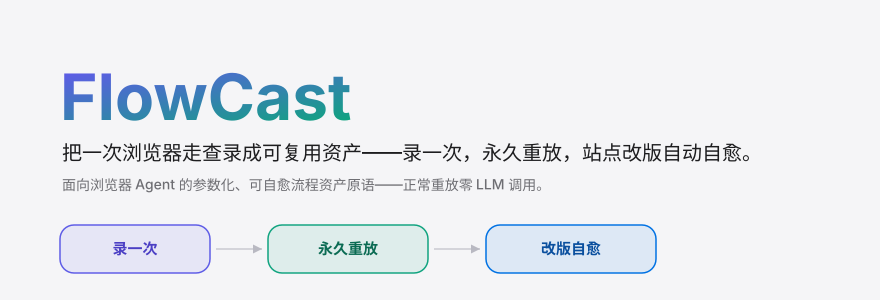
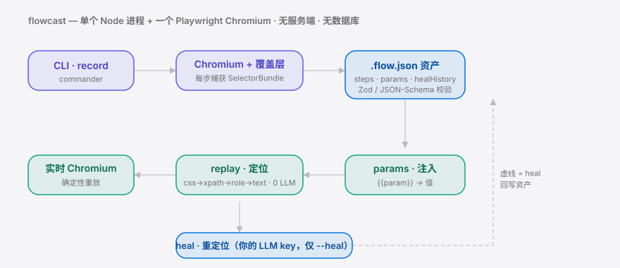
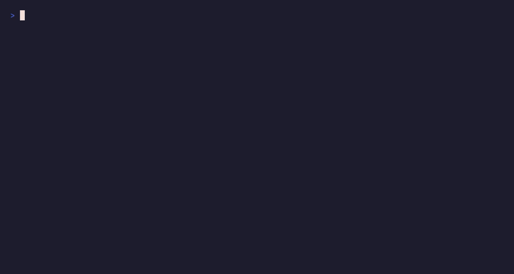

<div align="right"><sub><a href="./README.en.md">English</a>&nbsp;&nbsp;⇄&nbsp;&nbsp;<b>简体中文</b></sub></div>

<p align="center">
  <picture>
    <source media="(prefers-color-scheme: dark)" srcset="./assets/hero-cn-dark.svg">
    <source media="(prefers-color-scheme: light)" srcset="./assets/hero-cn-light.svg">
    
  </picture>
</p>

<p align="center"><sub>把一次浏览器演示固化为可自愈、可重放的 Agent 流程资产——录一次，永久重放，站点改版自动重定位。</sub></p>

<p align="center">
  <a href="./LICENSE"></a>
  
  <a href="https://github.com/SuperMarioYL/flowcast/actions/workflows/ci.yml"></a>
  = 22">
  
  
</p>

**你的浏览器 Agent 每跑一次同一条流程都在重新推理、改版就崩——FlowCast 把那一次走查录成参数化、可自愈的 `.flow.json` 资产，从此正常重放零 LLM 调用，selector 漂移自动修。**

##  架构

<p align="center">
  <picture>
    <source media="(prefers-color-scheme: dark)" srcset="./assets/atlas-cn-dark.svg">
    <source media="(prefers-color-scheme: light)" srcset="./assets/atlas-cn-light.svg">
    
  </picture>
</p>

单个 npm 包，一个 Node 进程 + 它拉起的 Chromium（Playwright 托管）——**无服务端、无数据库**。LLM 仅在 `--heal` 时调用，且用你自带的 key；正常重放零模型调用，这正是相对"每次 fresh inference"的核心收益。

## 目录

- [为什么需要它](#为什么需要它)
- [安装](#-安装)
- [快速开始](#-快速开始)
- [用法](#-用法)
- [Demo](#-demo)
- [配置](#-配置)
- [核心原语 flow-asset](#核心原语-flow-asset)
- [对比相邻方案](#对比相邻方案)
- [付费 / 托管层](#-付费--托管层)
- [路线图](#-路线图)
- [License](#-license)

## 为什么需要它

浏览器 Agent 今天的根本缺陷是：每次执行多步 web 任务都要**重新推理**该怎么做，并在 selector 漂移时**重新崩溃**——同一个流程跑十次就重新发现十次，成本与脆性反复发生。相邻生态已经验证了"自愈浏览器自动化"是真需求（如 [browser-use/browser-harness](https://github.com/browser-use/browser-harness) 的单次 live-run 自愈），但它跑完即弃、不产出可复用资产。

FlowCast 补的正是这块空白：把一次人工演示**结晶**成一份参数化、可自愈、可重放的流程资产。这是把一次性 demo 变成一项**持久的浏览器 Agent 能力**——和 [NousResearch/hermes-agent](https://github.com/NousResearch/hermes-agent) 这类把 "Agent" 推向可靠执行的项目同一条主线，但聚焦于"录一次、永久重放、改版自愈"这一具体原语。

##  安装

```bash
npm install -g flowcast          # 或直接 npx flowcast <command>
npx playwright install chromium  # 首次安装浏览器引擎
```

##  快速开始

仓库自带可跑样例资产，`clone` 后无需录制即可看到"零 LLM 重放"：

```bash
git clone https://github.com/SuperMarioYL/flowcast && cd flowcast
npm install && npx playwright install chromium
npx flowcast replay examples/login-and-export.flow.json
```

<details><summary>示例输出</summary>

```text
→ s1 goto https://the-internet.herokuapp.com/login
→ s2 fill (fill username)
→ s3 fill (fill password)
→ s4 click (click Login)
→ s5 waitFor
→ s6 extract = "Welcome to the Secure Area. When you are done click logout below."
Replay succeeded: 6 step(s) run.
Extracted:
  s6 = "Welcome to the Secure Area. When you are done click logout below."
```

</details>

##  用法

FlowCast 有三个子命令，对应"录 → 编辑参数化 → 重放/自愈"闭环：

```bash
# 1. 录一次：起 Chromium + 覆盖层，人工走一遍流程，关窗口即存为资产
npx flowcast record ./login.flow.json --url https://example.com/login

# 2. 参数化：本地 UI 把硬编码值改成 {{param}}、删多余步、声明参数
npx flowcast edit ./login.flow.json

# 3. 重放：注入参数，零 LLM 调用确定性重放
npx flowcast replay ./login.flow.json --param account=alice

# 4. 自愈：站点改版导致 selector 失效时，用你自己的 LLM key 对实时 DOM 重定位并回写资产
export FLOWCAST_LLM_API_KEY=sk-...          # 复用你已有的 key，不内置任何模型
npx flowcast replay ./login.flow.json --heal
```

更多可跑示例见 [`examples/`](./examples)。`record` / `replay` 支持 `--headed` 实时观察浏览器；`replay --heal --no-write` 可只在内存里自愈、不回写磁盘。

##  Demo

零 LLM 重放 → 手动破坏一个 selector 模拟改版 → `--heal` 自动修好并跑通：



##  配置

自愈复用你已有的 LLM API key（任何 OpenAI 兼容的 Chat Completions 端点），通过环境变量配置——**不内置、不微调任何模型**：

| 环境变量 | 类型 | 默认值 | 含义 |
|---|---|---|---|
| `FLOWCAST_LLM_API_KEY` | string | （无） | 自愈所需的 LLM API key；缺失时 `--heal` 报错。也可用 `OPENAI_API_KEY`。 |
| `FLOWCAST_LLM_BASE_URL` | string | `https://api.openai.com/v1` | OpenAI 兼容端点的 base URL（可指向自托管 / 第三方网关）。 |
| `FLOWCAST_LLM_MODEL` | string | `gpt-4o-mini` | 自愈重定位使用的模型名。 |

## 核心原语 flow-asset

新原语是 **flow-asset**：一份自描述、参数化、可自愈重放的捕获流程，落地为 `.flow.json`（JSON Schema 见 [`schema/flow-asset.schema.json`](./schema/flow-asset.schema.json)）。护城河在**自有资产格式 + 参数化 + 自愈重定位逻辑**，不是浏览器引擎。

自愈的关键是每步捕获一束冗余定位线索 `SelectorBundle`（`css` / `xpath` / `role`+`name` / `text` / `nthOfType`）。重放时按优先级逐一尝试；当站点改版让它们全部失配时，`--heal` 拿实时 DOM 快照 + 这束线索交给你的 LLM 重定位，并把修复写进该步的 `healHistory` 审计记录——资产越用越稳。

## 对比相邻方案

诚实定位（相邻玩家在各自擅长的点上确实更强）：

| 能力 | FlowCast | [browser-use/browser-harness](https://github.com/browser-use/browser-harness) | [NousResearch/hermes-agent](https://github.com/NousResearch/hermes-agent) |
|---|:---:|:---:|:---:|
| 把一次演示固化为**可复用资产** | ✓ | — | — |
| 正常重放**零 LLM 调用** | ✓ | — | — |
| selector 漂移后**自愈重定位** | ✓ (DOM 层) | ✓ (单次 live-run) | partial |
| 通用 "任意任务" Agent 推理 | — | ✓ | ✓ |
| 步骤参数化 `{{param}}` + 编辑 UI | ✓ | — | — |

FlowCast 不和它们抢"通用 Agent 推理"——而是补在它们下游：把跑通的那一次**留下来**。

##  付费 / 托管层

内核（捕获 / 重放原语 + 参数化 UI）**OSS-first 永久开源**，做分发与可信度。当你需要把同一流程**每天定时跑、跨人共享、失败告警**时，单文件本地资产就不够了——这是规划中的**托管 SaaS** 层要解决的：

| 形态 | 价格 | 包含 |
|---|---|---|
| 自托管 OSS | $0 | 本地资产 · 录制 / 编辑 / 重放 / 自愈 全功能 |
| Team（规划中） | $29/月 | 3 席 + 10 个托管资产 + 定时调度 + 失败告警 |
| 扩展席位（规划中） | $12/席/月 | 资产协作 · 权限 · 运行历史 |

> v0.1 **不建任何付费墙**，托管层是验证付费意愿后的下一步。想要托管 / 团队版可在 [issues](https://github.com/SuperMarioYL/flowcast/issues) 留言。

##  路线图

- [x] **m1 — record & replay**：录一次多步走查 → 写出符合 schema 的 `.flow.json`，零重推理重放成功
- [x] **m2 — parameterize & heal**：编辑 UI 参数化捕获步骤；`replay --heal` 对实时 DOM 自愈重定位并回写
- [x] **m3 — polished demo & example**：自带可跑样例资产 + demo 脚本 + 双语 README
- [ ] 托管 SaaS：资产云托管 · 定时调度 · 跨人共享 · 运行历史 / 失败告警
- [ ] 团队版：协作 · 权限 · 审计日志

## 贡献

欢迎 issue 与 PR。发现 bug 或想要某个能力，请[新建 issue](https://github.com/SuperMarioYL/flowcast/issues)；改代码请先开 issue 对齐范围，再提 PR。

##  License

[MIT](./LICENSE)。

## Share this

```text
FlowCast — 把一次浏览器演示录成可自愈、可重放的 Agent 流程资产。录一次，永久重放，
站点改版 --heal 自动重定位，正常重放零 LLM 调用。 https://github.com/SuperMarioYL/flowcast
```

<p align="center"><sub><a href="./LICENSE">MIT</a> © 2026 SuperMarioYL</sub></p>
