[English](README.en.md) | **简体中文**

<picture>
  <source media="(max-width: 640px) and (prefers-color-scheme: dark)" srcset="assets/presentation/hero-mobile-dark.svg">
  <source media="(max-width: 640px)" srcset="assets/presentation/hero-mobile-light.svg">
  <source media="(prefers-color-scheme: dark)" srcset="assets/presentation/hero-dark.svg">
  
</picture>

**录制、编辑和重放带参数的浏览器流程，用结构化资产保存步骤与定位线索。**

`v0.6.0` · `Node.js 22+` · [Apache-2.0](LICENSE)

[Website](https://flowcast.lei6393.com) · [Demo record](docs/demo-results.json)

## 为什么使用

登录、填表和提取内容等重复操作，通常包含固定步骤与少量变化参数。FlowCast 把步骤保存为 .flow.json，把输入作为参数注入，方便重跑和审阅。页面变化时先尝试已有定位线索，全部失败后才进入可选的模型修复路径。

## 架构

<picture>
  <source media="(max-width: 640px) and (prefers-color-scheme: dark)" srcset="assets/presentation/architecture-mobile-dark.svg">
  <source media="(max-width: 640px)" srcset="assets/presentation/architecture-mobile-light.svg">
  <source media="(prefers-color-scheme: dark)" srcset="assets/presentation/architecture-dark.svg">
  
</picture>

asset.ts 的 Zod schema 定义动作、参数与 SelectorBundle。record 捕获浏览器操作，params 解析变量，replay 用 Playwright 执行 goto/fill/click/select/waitFor/extract。heal 将 DOM 与线索提交给配置的模型并记录 healHistory；编辑器在本地提供资产修改界面。

源码入口：[src/asset.ts](src/asset.ts) · [src/params.ts](src/params.ts) · [src/replay.ts](src/replay.ts) · [src/record.ts](src/record.ts) · [src/heal.ts](src/heal.ts) · [src/cli.ts](src/cli.ts) · [schema/flow-asset.schema.json](schema/flow-asset.schema.json)

## 安装

需要 Node.js 22+ 和 Chromium。演示启动临时本地 HTTP 服务，使用真实无头浏览器访问，不需要远端站点。

```bash
git clone https://github.com/SuperMarioYL/flowcast.git
cd flowcast
npm ci
npm run build
npx playwright install chromium
```

## 快速开始

自包含脚本提供完整 HTML 与四步资产，注入 name=Lin 后填写表单并提取结果。没有调用 LLM，也未验证远端网站或自动修复。

```bash
node examples/presentation-demo.mjs
```

完整输入与执行步骤见上方命令及 [Demo 记录](docs/demo-results.json)。

## 使用

```bash
node dist/cli.js validate examples/login-and-export.flow.json
node dist/cli.js record login.flow.json --url https://example.com/login
node dist/cli.js edit login.flow.json
node dist/cli.js replay login.flow.json --param account=alice
```
录制时请改用你可访问的实际页面。`--headed` 显示重放窗口；`replay --heal --no-write` 在当前运行内修复而不保存资产。参数必须由资产声明或步骤引用，缺少必要参数会报错。

## 实际 Demo

<picture>
  <source media="(max-width: 640px) and (prefers-color-scheme: dark)" srcset="assets/presentation/process-mobile-dark.svg">
  <source media="(max-width: 640px)" srcset="assets/presentation/process-mobile-light.svg">
  <source media="(prefers-color-scheme: dark)" srcset="assets/presentation/process-dark.svg">
  
</picture>

### 重放本地表单

返回 ok=true、stepsRun=4 与 Hello, Lin。

```text
$ node examples/presentation-demo.mjs
{
  "ok": true,
  "stepsRun": 4,
  "extracted": {
    "result": "Hello, Lin"
  },
  "healed": false
}
```

## 能力与接入

<picture>
  <source media="(max-width: 640px) and (prefers-color-scheme: dark)" srcset="assets/presentation/integrations-mobile-dark.svg">
  <source media="(max-width: 640px)" srcset="assets/presentation/integrations-mobile-light.svg">
  <source media="(prefers-color-scheme: dark)" srcset="assets/presentation/integrations-dark.svg">
  
</picture>

正常重放无需模型。record 与 edit 需要交互式浏览器；validate 只检查资产结构与参数。启用 heal 后，页面 DOM 会发送给所配置的 Chat Completions 服务。


## 配置

自愈读取 `FLOWCAST_LLM_API_KEY`（或 OPENAI_API_KEY）、`FLOWCAST_LLM_BASE_URL` 与 `FLOWCAST_LLM_MODEL`。步骤可设置 timeoutMs；冗余线索包括 CSS、XPath、role/name、text 与结构位置。示例不含私有凭证；实际资产中的填充值应自行检查。

## 路线图与范围

当前包含录制、编辑、验证、重放及可选修复。托管调度、跨团队协作与失败通知属于后续服务方向。

- 页面布局、认证和业务逻辑变化都可能使资产失效，重放或模型修复不保证永久成功。
- 演示仅测试本地表单重放，没有测试录制 UI 或实际模型修复。

 · [Recording script](docs/demo.tape)

## 许可证

[Apache-2.0](LICENSE)
